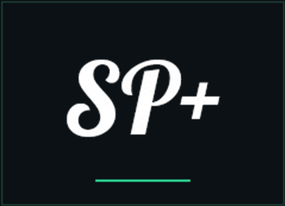
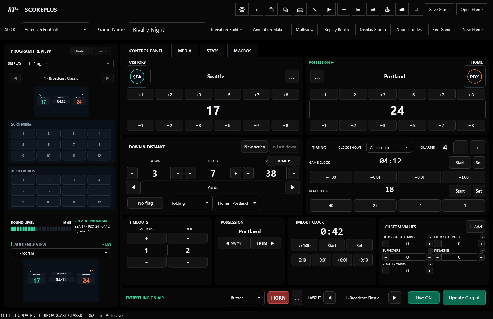

<p align="center">
  <a href="https://github.com/lhultimate/ScorePlus/releases">
    
  </a>
</p>

<h1 align="center">ScorePlus</h1>

<p align="center"><strong>A Windows scoreboard and broadcast graphics system for live production.</strong></p>

<p align="center">One WPF application for the operator console and every audience output. This README is the developer guide: build, test, release and understand the codebase.</p>

<p align="center">
  <a href="https://github.com/lhultimate/ScorePlus/releases"></a>
  
  
  <a href="https://github.com/lhultimate/ScorePlus/wiki"></a>
</p>

<p align="center">
  
</p>

> **Beta software.** ScorePlus ships frequent beta builds under labels like `b1.1`. The operator manual and tutorials live in the [ScorePlus Wiki](https://github.com/lhultimate/ScorePlus/wiki); the [website](https://lhultimate.github.io/ScorePlus) is the product tour and download page.

**ScorePlus is in no way affiliated with, endorsed by, or connected to Renewed Vision or ProScoreboard.**

---

## Where things live

| Path | What it is |
| --- | --- |
| [`src/Scoreboard.Core`](src/Scoreboard.Core) | .NET class library: game state, engine, sport catalog, scorebug model, data tokens, file formats, reports |
| [`src/Scoreboard.Desktop`](src/Scoreboard.Desktop) | WPF application: operator console, Display Studio, media bay, replay, rosters, macros, remote server and audience windows |
| [`src/ScorePlus.Setup`](src/ScorePlus.Setup) | Self-contained installer: embeds the published app, writes shortcuts and the uninstall entry |
| [`tests/Scoreboard.Core.Tests`](tests/Scoreboard.Core.Tests) | Headless tests for scoring, clocks, stats, profiles, files and reports |
| [`tests/UiSmoke`](tests/UiSmoke) | Loads every window and exercises the operator flows |
| [`tests/HtmlRender`](tests/HtmlRender) | Draws an HTML element in a real browser event loop |
| [`site/`](site) | Static marketing and download page served by GitHub Pages |
| [`docs/`](docs) | Update-feed notes and third-party notices |
| [`scripts/`](scripts) | Release build and GitHub publishing scripts |

## How the pieces fit

```
Scoreboard.Core
   ├── game state, clocks, sport profiles, scorebug model, tokens, files
   ├── consumed by Scoreboard.Desktop (console, studio, output, remote)
   └── consumed by tests and the report writer

Scoreboard.Desktop
   ├── MainWindow / GameControlWindow   operator console
   ├── DisplayStudioWindow              layout and motion editor
   ├── MediaDock / ReplayBooth          clips, cameras and replay
   ├── OutputWindow / MultiviewWindow   audience and monitoring surfaces
   └── Remote server                    phone/tablet console and wall board

ScorePlus.Setup
   └── compresses the published exe into an installer payload
```

The desktop app is the only UI layer. Game state and the rules around it belong in `Scoreboard.Core`; new behaviour should go there first when it can be tested without a window. WPF windows and docks bind to the engine and should not become a second source of truth.

## Requirements

- **Windows 10/11, 64-bit** for running or building the WPF app.
- **.NET 10 SDK** with the Windows desktop targeting pack.
- **Git Bash** (or another Bash) for `scripts/*.sh`.
- **Python 3** for the release script's installer payload.
- **GitHub CLI (`gh`)**, authenticated, only when publishing a release.

The shipped app is self-contained. End users do not install .NET.

## Build and run

Restore and build the desktop app:

```sh
dotnet build src/Scoreboard.Desktop/Scoreboard.Desktop.csproj -c Debug
```

Run it from source:

```sh
dotnet run --project src/Scoreboard.Desktop/Scoreboard.Desktop.csproj
```

The app opens on the launch box; create or open a game from there. For a release-shaped build with the installer, use the release script:

```sh
./scripts/build-release.sh b1.2
```

Output lands in `dist/ScorePlus-win-x64-b1.2/`:

```
ScorePlusPortable.exe   self-contained app
ScorePlusSetup.exe      installer containing the app
README.md               this guide
UPDATES.md              update-feed notes
docs/                   third-party notices
```

## Tests

```sh
dotnet run --project tests/Scoreboard.Core.Tests/Scoreboard.Core.Tests.csproj -c Release
dotnet run --project tests/UiSmoke/UiSmoke.csproj -c Release
dotnet run --project tests/HtmlRender/HtmlRender.csproj -c Release
```

`HtmlRender` is separate because the browser engine needs the app's own event loop; the UI smoke harness drives the dispatcher itself.

The suites cover scoring, undo, clock behaviour, period formats, sport profiles and overrides, custom stats and tokens, live-versus-staged publishing, displays and layouts, linked and copied parts, typography and transitions, icon artwork, media tags, camera and replay staging, roster files, the advertisement log, layout/display/media-folder files, report output, the remote page, the installer update path, and the studio's keyboard and canvas behaviour.

## Release and update flow

`scripts/publish-release.sh` builds the release, writes `win.json`, and optionally creates the GitHub release:

```sh
./scripts/publish-release.sh b1.2 --release --prerelease --notes "Adds X, fixes Y"
```

- The release must carry **`ScorePlusSetup.exe`** and **`ScorePlusPortable.exe`**.
- Installed copies update from the setup exe after verifying GitHub's SHA-256 asset digest.
- Portable copies never check for updates and never replace themselves.
- Release numbers must increase; alpha, beta and stable live on separate numeric stages. The rules are in [docs/updates.md](docs/updates.md) and the [wiki Updates page](https://github.com/lhultimate/ScorePlus/wiki/Updates).
- Beta releases are **prereleases**, so `releases/latest` skips them. Use the [releases page](https://github.com/lhultimate/ScorePlus/releases) or the releases API when you need the newest beta.

The website resolves the newest published release, including prereleases, at runtime and points its installer and portable buttons at the matching assets.

## Documentation

Operator documentation is deliberately kept out of this README. The wiki is the manual; start with the pages below.

| Page | Why a developer should read it |
| --- | --- |
| [Getting Started](https://github.com/lhultimate/ScorePlus/wiki/Getting-Started) | The intended first-run flow and the vocabulary the UI uses |
| [The Console](https://github.com/lhultimate/ScorePlus/wiki/Console) | Every control and the live-versus-staged model |
| [Display Studio](https://github.com/lhultimate/ScorePlus/wiki/Display-Studio) | How layouts, elements, transitions and parts behave |
| [Studio Reference](https://github.com/lhultimate/ScorePlus/wiki/Studio-Reference) | Element types, properties and keyboard controls |
| [Media, Cameras and Replay](https://github.com/lhultimate/ScorePlus/wiki/Media-and-Replay) | Tags, speaker routing, capture and staged replay |
| [Data Tokens](https://github.com/lhultimate/ScorePlus/wiki/Data-Tokens) | The token language used by layouts and HTML elements |
| [Files and Folders](https://github.com/lhultimate/ScorePlus/wiki/Files-and-Folders) | File types and the `%LOCALAPPDATA%\ScorePlus` layout |
| [Building and Releasing](https://github.com/lhultimate/ScorePlus/wiki/Building-and-Releasing) | The release ritual and asset naming |
| [Project and Tests](https://github.com/lhultimate/ScorePlus/wiki/Project-and-Tests) | Repository layout and test suites |
| [Troubleshooting](https://github.com/lhultimate/ScorePlus/wiki/Troubleshooting) | Known venue failures and their causes |

The [wiki home](https://github.com/lhultimate/ScorePlus/wiki) links every page, including the full tutorial set that used to live here.

## Contributing

- Open an issue for a bug or a feature before a large change, so the behaviour can be pinned down.
- Keep game rules and state in `Scoreboard.Core`; keep WPF concerns in `Scoreboard.Desktop`.
- Add or update a headless test when changing scoring, clocks, files, tokens or reports. Use `UiSmoke` for operator flows that need a window.
- Keep operator-facing instructions in the wiki, not in code comments or this README.
- Do not commit build output from `dist/`, generated `bin/`/`obj/`, preferences, logs, or release assets.

## Project status

ScorePlus is an evolving production tool, not yet a full broadcast package. Network and hardware control, multi-game communication and media launch from the remote are the main areas still under construction. The [Roadmap](https://github.com/lhultimate/ScorePlus/wiki/Roadmap) tracks them.

Linux builds are maintained separately at [MysteriousJose/ScorePlus-Linux](https://github.com/MysteriousJose/ScorePlus-Linux) and are not officially supported.

---

<sub>ScorePlus · developer guide · operator manual at <a href="https://github.com/lhultimate/ScorePlus/wiki">github.com/lhultimate/ScorePlus/wiki</a></sub>
